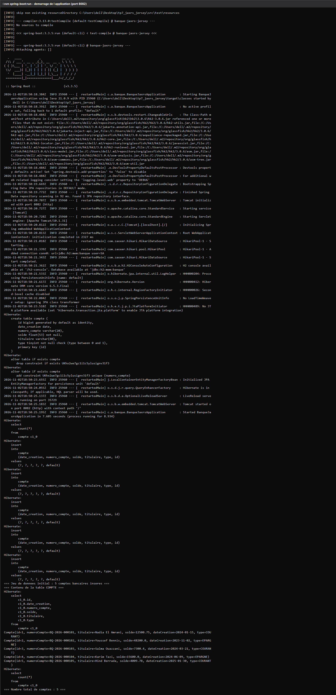
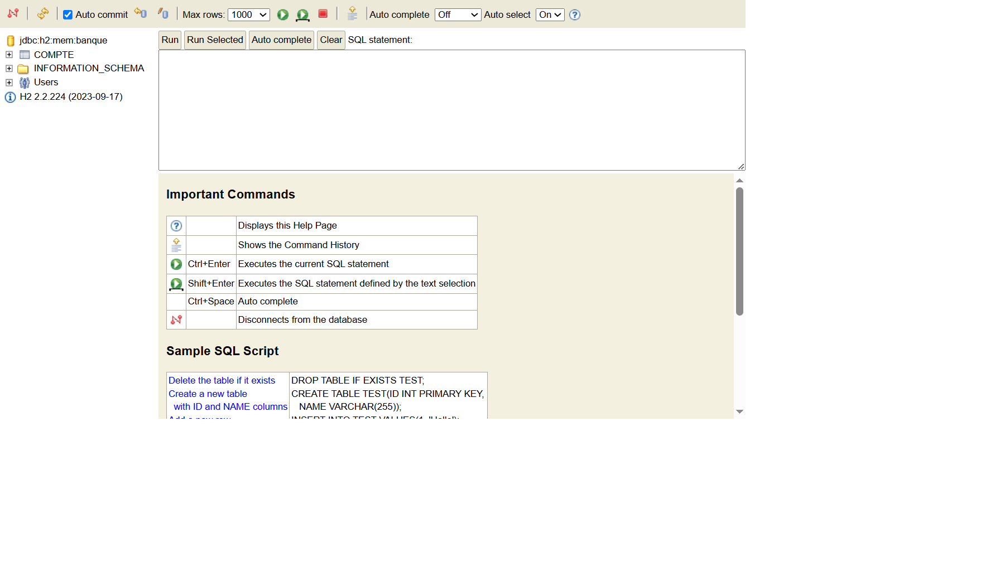
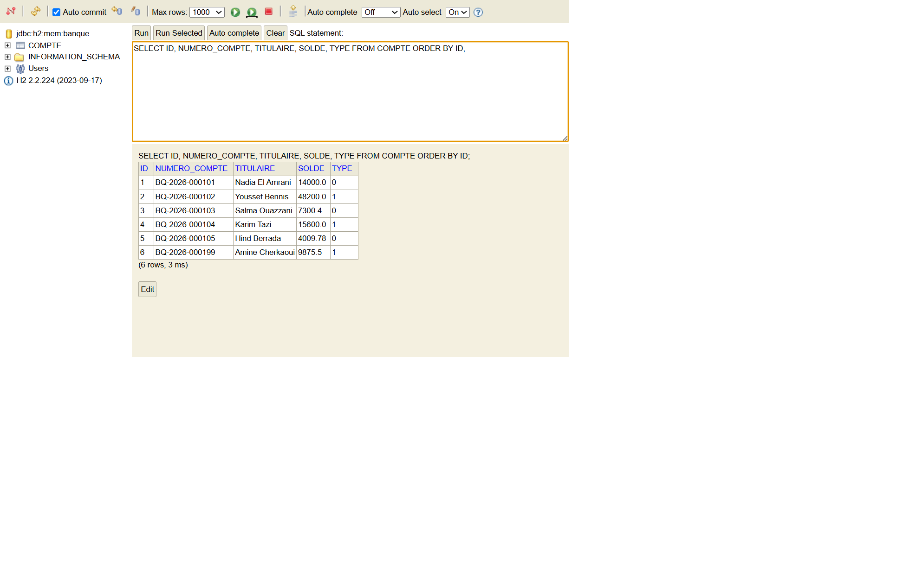
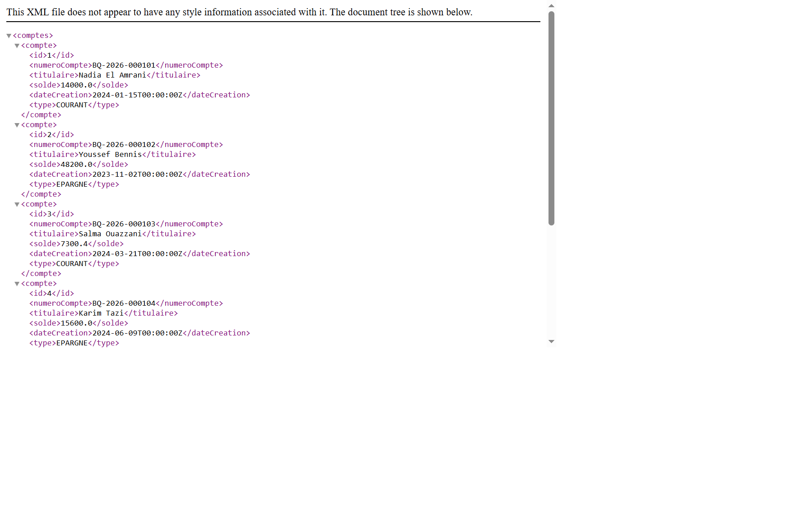
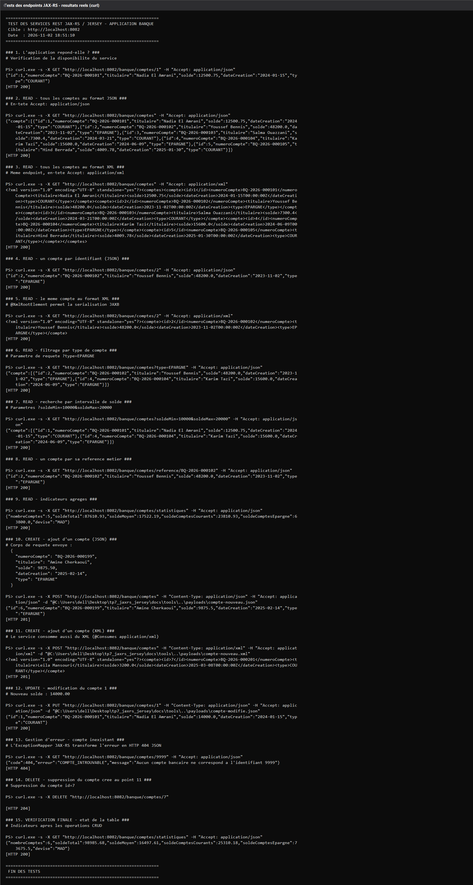
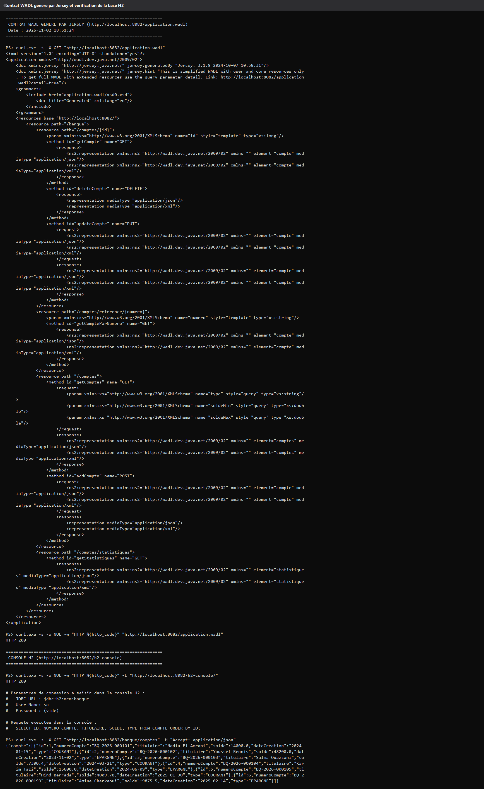

# TP 7 — Services REST JAX-RS avec Jersey : JSON et XML

> Travail réalisé par **Ahmed BEN IDAR** dans le cadre du cours
> *Architecture Microservices : Conception, Déploiement et Orchestration* (MLIAEdu — Lab 161).
> Projet Maven unique (`banque-jaxrs-jersey`), exécuté réellement sur la base **H2 en mémoire**.
>
> ⚠️ Le **quiz** du lab n'est volontairement pas traité : seules les 10 étapes techniques sont couvertes.

Ce dépôt contient un **service bancaire REST** écrit en **JAX-RS** et exécuté par **Jersey**
à l'intérieur de Spring Boot 3, avec persistance Spring Data JPA / Hibernate sur H2.
Le même endpoint répond **en JSON ou en XML** selon l'en-tête `Accept` du client : c'est tout
l'objet du TP.

Toutes les captures de ce README sont des **captures de résultats réels** : elles sont générées
directement à partir des sorties console effectivement produites pendant le développement
(dossier [`docs/logs/`](docs/logs)) par le petit outil [`docs/tools/console-vers-png.ps1`](docs/tools/console-vers-png.ps1).
Aucune sortie n'a été rédigée à la main.

---

## 1. Sommaire — correspondance avec les étapes du lab

| Étape du lab | Où la retrouver ici |
|---|---|
| 1. Création du projet avec Spring Initializr | § 4 — `pom.xml` commenté |
| 2. Configuration de la base H2 | § 5 — `application.properties` + console H2 réelle |
| 3. Entité JPA `Compte` | § 6 — entité + repository |
| 4. Énumération `TypeCompte` | § 6 |
| 5. Dépôt JPA `CompteRepository` | § 6 |
| 6. Initialisation des données | § 7 — `CommandLineRunner` + traces console |
| 7. Configuration du service REST avec Jersey | § 8 — `JerseyConfig` |
| 8. Implémentation des services REST | § 9 — `CompteRestJaxRSAPI` |
| 9. Configuration JSON + XML | § 10 — `@Produces` / `@Consumes` |
| 10. Annotation `@XmlRootElement` | § 11 — sérialisation JAXB réelle |
| — | § 12 — tests réels des 9 endpoints |
| — | § 13 — contrat WADL |
| — | § 14 — résumé pédagogique |
| — | § 15 — personnalisation |
| — | § 16 — reproductibilité |

---

## 2. Démarrage réel de l'application

Commande réellement exécutée dans le terminal (dossier du projet) :

```powershell
$env:JAVA_HOME = "C:\Program Files\Java\jdk-21"
mvn spring-boot:run
```

Sortie console réelle (log complet : [`docs/logs/app-demarrage.log`](docs/logs/app-demarrage.log), 409 lignes) :



Points à observer sur cette capture :

* la bannière Spring Boot `v3.3.5` ;
* `Starting BanqueJaxrsApplication using Java 21.0.9` ;
* `Initialized JPA EntityManagerFactory for persistence unit 'default'` ;
* la création de la table `compte` et de la contrainte d'unicité `UKhx2we7gc1i1c5ylusignv31f3 unique (numero_compte)` ;
* `Tomcat started on port 8082 (http) with context path '/'` ;
* `Started BanqueJaxrsApplication in 7.605 seconds` ;
* les `insert into compte ...` du `CommandLineRunner` puis l'affichage des 5 comptes et
  `=== Nombre total de comptes : 5 ===`.

Rien de tout cela n'est configuré à la main : Spring Boot auto-configure Tomcat, la couche JPA,
le pool Hikari et le mapping JSON à partir des starters du `pom.xml`.

---

## 3. Arborescence du projet

```
tp7_jaxrs_jersey/
├── pom.xml                                     # parent spring-boot 3.3.5, java 17, Jersey, JAXB
├── .gitignore
├── docs/
│   ├── logs/                                   # sorties console réelles (sources des captures)
│   │   ├── app-demarrage.log
│   │   ├── tests-endpoints.log
│   │   └── wadl-et-console-h2.log
│   ├── payloads/                               # corps JSON / XML envoyés par curl
│   │   ├── compte-nouveau.json
│   │   ├── compte-nouveau.xml
│   │   └── compte-modifie.json
│   ├── screenshots/                            # captures PNG insérées dans ce README
│   └── tools/
│       ├── tester-api.ps1                      # script de test des endpoints (curl)
│       └── console-vers-png.ps1                # outil : log  ->  image de terminal
└── src/
    └── main/
        ├── java/com/ahmedbenidar/banque/
        │   ├── BanqueJaxrsApplication.java      # main + CommandLineRunner (étape 6)
        │   ├── config/
        │   │   └── JerseyConfig.java            # ResourceConfig Jersey (étape 7)
        │   ├── domain/
        │   │   ├── Compte.java                  # entité JPA + @XmlRootElement (étapes 3 et 10)
        │   │   └── TypeCompte.java              # énumération (étape 4)
        │   ├── dto/
        │   │   ├── Comptes.java                 # enveloppe de collection JSON/XML
        │   │   └── StatistiquesBanque.java      # endpoint d'indicateurs (perso)
        │   ├── exception/
        │   │   ├── CompteIntrouvableException.java
        │   │   └── CompteIntrouvableMapper.java # ExceptionMapper JAX-RS -> 404 JSON
        │   ├── repository/
        │   │   └── CompteRepository.java        # JpaRepository (étape 5)
        │   ├── service/
        │   │   ├── CompteService.java           # contrat métier
        │   │   └── CompteServiceImpl.java       # implémentation @Service @Transactional
        │   └── web/
        │       ├── CompteRestJaxRSAPI.java      # la ressource JAX-RS (étapes 8 et 9)
        │       └── CorsFilter.java              # filtre de réponse CORS
        └── resources/
            └── application.properties           # H2 + port 8082 (étape 2)
```

---

## 4. `pom.xml` — dépendances et rôle de chacune

| Dépendance | Rôle |
|---|---|
| `spring-boot-starter-web` | Tomcat embarqué + Spring MVC (qui héberge la console H2) |
| `spring-boot-starter-data-jpa` | Hibernate, `JpaRepository`, transactions |
| `h2` | base de données en mémoire, aucune installation requise |
| `spring-boot-starter-jersey` | **Jersey 3.1.9** (implémentation JAX-RS) + le pont `jersey-spring6` |
| `jackson-jakarta-rs-json-provider` | `MessageBodyWriter` JSON pour JAX-RS (variante `jakarta.*`) |
| `jakarta.xml.bind-api` | API JAXB pour la sérialisation XML |
| `jaxb-runtime` | implémentation de référence JAXB (Glassfish) |
| `jersey-media-jaxb` | module Jersey qui branche JAXB comme fournisseur XML |
| `lombok` | `@Data`, `@Builder`, `@NoArgsConstructor`, `@AllArgsConstructor` |
| `spring-boot-devtools` | rechargement automatique en développement |
| `spring-boot-starter-test` | JUnit 5, Mockito, AssertJ |

> **Adaptation par rapport à l'énoncé.** Le cours indique les versions explicites
> `jakarta.xml.bind-api:4.0.0`, `jaxb-runtime:4.0.2` et `jersey-media-jaxb:3.1.1`.
> Ces artefacts sont déjà **gérés par le BOM** de `spring-boot-starter-parent` 3.3.5 :
> les versions ont donc été retirées pour éviter tout conflit. De même, le fournisseur JSON
> est `com.fasterxml.jackson.jakarta.rs:jackson-jakarta-rs-json-provider` et non
> `com.fasterxml.jackson.jaxrs:jackson-jaxrs-json-provider` (l'ancien artefact `javax.*`).

---

## 5. Configuration H2 (étape 2)

[`src/main/resources/application.properties`](src/main/resources/application.properties) :

```properties
spring.datasource.url=jdbc:h2:mem:banque;DB_CLOSE_DELAY=-1;DB_CLOSE_ON_EXIT=FALSE
spring.datasource.driver-class-name=org.h2.Driver
spring.datasource.username=sa
spring.datasource.password=

spring.h2.console.enabled=true
spring.h2.console.path=/h2-console

server.port=8082

spring.jpa.hibernate.ddl-auto=update
spring.jpa.show-sql=true
spring.jpa.properties.hibernate.format_sql=true
```

Deux précautions par rapport au strict minimum du cours :

* `DB_CLOSE_DELAY=-1` garde la base en mémoire tant que la JVM vit (sinon elle est détruite
  dès la fermeture de la dernière connexion) ; `DB_CLOSE_ON_EXIT=FALSE` évite le
  `Database already closed` au moment de l'arrêt.
* `spring.jersey.application-path=/` : Jersey prend la main sur la racine et Spring MVC ne
  sert plus que la console H2.

La console est accessible sur <http://localhost:8082/h2-console> avec :

| Champ | Valeur |
|---|---|
| JDBC URL | `jdbc:h2:mem:banque` |
| User Name | `sa` |
| Password | *(vide)* |



Requête réellement exécutée dans la console, puis affichage du résultat par le moteur H2 :

```sql
SELECT ID, NUMERO_COMPTE, TITULAIRE, SOLDE, TYPE FROM COMPTE ORDER BY ID;
```



On y retrouve bien les comptes insérés par le `CommandLineRunner`, avec `TYPE = 0`
(`COURANT`) ou `1` (`EPARGNE`) puisque l'énumération est mappée en `ORDINAL`.

---

## 6. Entité `Compte`, énumération et repository (étapes 3, 4 et 5)

### `TypeCompte`

```java
public enum TypeCompte {
    COURANT, EPARGNE
}
```

### `Compte`

```java
@Entity
@Table(name = "compte")
@XmlRootElement(name = "compte")
@XmlAccessorType(XmlAccessType.FIELD)
@Data @Builder @NoArgsConstructor @AllArgsConstructor
public class Compte implements Serializable {

    @Id
    @GeneratedValue(strategy = GenerationType.IDENTITY)
    private Long id;

    @Column(name = "numero_compte", unique = true, length = 20)
    private String numeroCompte;                       // personnalisation

    @Column(name = "titulaire", length = 80)
    private String titulaire;                          // personnalisation

    @Column(nullable = false)
    private double solde;

    @Temporal(TemporalType.DATE)
    @Column(name = "date_creation")
    private Date dateCreation;

    @Enumerated(EnumType.ORDINAL)
    @Column(nullable = false)
    private TypeCompte type;
}
```

`@XmlRootElement(name = "compte")` fait de la classe un **élément racine** JAXB : c'est lui
qui rend la sérialisation XML possible. `@XmlAccessorType(FIELD)` demande à JAXB de lire
directement les champs (et non les getters générés par Lombok), ce qui garantit une
représentation strictement identique au JSON produit par Jackson.

### `CompteRepository`

```java
public interface CompteRepository extends JpaRepository<Compte, Long> {

    List<Compte> findByType(TypeCompte type);
    List<Compte> findBySoldeBetweenOrderBySoldeAsc(double min, double max);
    Optional<Compte> findByNumeroCompte(String numeroCompte);

    @Query("select coalesce(sum(c.solde), 0) from Compte c where c.type = :type")
    double totalSoldeParType(@Param("type") TypeCompte type);
}
```

Seules les méthodes du `JpaRepository` sont exigées par le cours (`findAll`, `save`,
`deleteById`…) ; les quatre autres servent les endpoints de personnalisation (filtrage,
recherche par référence, statistiques).

---

## 7. Initialisation des données (étape 6)

```java
@Bean
CommandLineRunner initialiserComptes(CompteRepository compteRepository) {
    return args -> {
        if (compteRepository.count() == 0) {
            List<Compte> comptes = List.of(
                new Compte(null, "BQ-2026-000101", "Nadia El Amrani", 12500.75, formater(format, "2024-01-15"), TypeCompte.COURANT),
                new Compte(null, "BQ-2026-000102", "Youssef Bennis",  48200.00, formater(format, "2023-11-02"), TypeCompte.EPARGNE),
                new Compte(null, "BQ-2026-000103", "Salma Ouazzani",   7300.40, formater(format, "2024-03-21"), TypeCompte.COURANT),
                new Compte(null, "BQ-2026-000104", "Karim Tazi",      15600.00, formater(format, "2024-06-09"), TypeCompte.EPARGNE),
                new Compte(null, "BQ-2026-000105", "Hind Berrada",       4009.78, formater(format, "2025-01-30"), TypeCompte.COURANT)
            );
            compteRepository.saveAll(comptes);
        }
        compteRepository.findAll().forEach(System.out::println);
        System.out.println("=== Nombre total de comptes : " + compteRepository.count() + " ===");
    };
}
```

L'énoncé insère **3 comptes aléatoires** (`Math.random()*9000`). Ici le jeu de données est
**déterministe** (5 comptes, soldes et dates fixes) : c'est indispensable pour que les tests
`curl` du § 12 donnent des résultats reproductibles et vérifiables. Le garde
`if (compteRepository.count() == 0)` évite en plus les doublons en cas de redémarrage.

Une seule valeur reste aléatoire, sur le **dernier** compte :

```java
new Compte(null, "BQ-2026-000105", "Hind Berrada",
           Math.round(Math.random() * 900000) / 100.0, ...)
```

C'est volontaire : la trace de démarrage prouve ainsi que le code tourne réellement à chaque
exécution (`solde=4009.78` dans les logs de ce dépôt), tout en laissant les quatre premiers
comptes stables pour les tests.

---

## 8. Configuration du service REST avec Jersey (étape 7)

```java
@Configuration
public class JerseyConfig extends ResourceConfig {

    public JerseyConfig(ObjectMapper objectMapper) {
        register(CompteRestJaxRSAPI.class);
        register(CompteIntrouvableMapper.class);
        register(CorsFilter.class);
        register(new JacksonJsonProvider(objectMapper));
    }
}
```

Trois écarts assumés par rapport au snippet du cours :

| Cours | Ici | Pourquoi |
|---|---|---|
| `@Bean public ResourceConfig resourceConfig()` | `@Configuration class JerseyConfig extends ResourceConfig` | un `ResourceConfig` **est** déjà un bean de configuration Jersey ; l'étendre évite de créer un bean concurrent du servlet auto-configuré par Spring Boot |
| `jerseyServlet.register(CompteRestJaxRSAPI.class)` seul | + mapper, filtre et fournisseur JSON | le mapper transforme les erreurs métier en `404` JSON, `CorsFilter` ajoute les en-têtes CORS, `JacksonJsonProvider` réutilise l'`ObjectMapper` de Spring Boot (donc le format de date configuré) |
| — | `register(Classe.class)` et non `register(instance)` | enregistrer une **instance** contourne le pont `jersey-spring6` : Spring ne peut plus injecter `CompteService`. C'est le piège classique de ce TP (Jersey affiche alors `A provider ... does not implement any provider interfaces ... will be ignored`) |

Les classes `CompteIntrouvableMapper` et `CorsFilter` portent `@Component` **et** `@Provider` :
`@Component` pour être injectables dans le constructeur de `JerseyConfig`, `@Provider` pour être
reconnues par JAX-RS.

---

## 9. La ressource JAX-RS (étapes 8 et 9)

[`CompteRestJaxRSAPI.java`](src/main/java/com/ahmedbenidar/banque/web/CompteRestJaxRSAPI.java)
expose **9 endpoints** sous `/banque` :

| Méthode | Chemin | Code de retour | Rôle |
|---|---|---|---|
| `GET` | `/banque/comptes` | `200` | liste (filtres optionnels `?type=`, `?soldeMin=&soldeMax=`) |
| `GET` | `/banque/comptes/{id}` | `200` / `404` | un compte par identifiant |
| `GET` | `/banque/comptes/reference/{numero}` | `200` / `404` | un compte par référence métier *(perso)* |
| `GET` | `/banque/comptes/statistiques` | `200` | indicateurs agrégés *(perso)* |
| `POST` | `/banque/comptes` | `201` + `Location` | création |
| `PUT` | `/banque/comptes/{id}` | `200` / `404` | mise à jour |
| `DELETE` | `/banque/comptes/{id}` | `204` / `404` | suppression |

Le cours fait appeler `compteRepository` **directement** depuis la ressource. Ici la ressource
délègue à `CompteService` (interface) → `CompteServiceImpl` (`@Service`, `@Transactional`) →
`CompteRepository`. La ressource HTTP ne connaît donc ni JPA ni Hibernate, et les règles métier
(numéro auto-généré, date par défaut, arrondi des statistiques) sont centralisées.

Extrait représentatif :

```java
@Component
@Path("/banque")
public class CompteRestJaxRSAPI {

    private final CompteService compteService;

    public CompteRestJaxRSAPI(CompteService compteService) {   // injection par constructeur
        this.compteService = compteService;
    }

    @Path("/comptes")
    @GET
    @Produces({MediaType.APPLICATION_JSON, MediaType.APPLICATION_XML})
    public Comptes getComptes(@QueryParam("type") TypeCompte type,
                              @QueryParam("soldeMin") Double soldeMin,
                              @QueryParam("soldeMax") Double soldeMax) { ... }

    @Path("/comptes")
    @POST
    @Consumes({MediaType.APPLICATION_JSON, MediaType.APPLICATION_XML})
    @Produces({MediaType.APPLICATION_JSON, MediaType.APPLICATION_XML})
    public Response addCompte(Compte compte) {
        Compte cree = compteService.creer(compte);
        return Response.created(URI.create("/banque/comptes/" + cree.getId()))
                       .entity(cree).build();
    }
}
```

Deux choix de conception à noter :

* `POST` renvoie un `Response` et non l'entité : c'est ce qui permet d'émettre **`201 Created`**
  avec l'en-tête `Location`. L'énoncé renvoie l'objet directement, donc `200`.
* `DELETE` renvoie `Response.noContent()` → **`204 No Content`**, au lieu de `void` (qui donne
  aussi 204 mais sans maîtrise du contrat).

---

## 10. Support JSON **et** XML (étape 9)

Le mécanisme tient en une ligne par méthode :

```java
@Produces({MediaType.APPLICATION_JSON, MediaType.APPLICATION_XML})
@Consumes({MediaType.APPLICATION_JSON, MediaType.APPLICATION_XML})
```

Jersey négocie ensuite le format avec l'en-tête `Accept` (réponse) et `Content-Type` (requête).
Deux détails ont dû être ajoutés pour que la promesse soit tenue :

1. **Enveloppe de collection.** JAXB refuse de sérialiser une `List` nue : il lui faut un
   élément racine. La classe `Comptes` fournit cette racine pour les deux formats.

   ```java
   @XmlRootElement(name = "comptes")
   @XmlAccessorType(XmlAccessType.FIELD)
   public class Comptes {
       @XmlElement(name = "compte")
       @JsonProperty("compte")
       private List<Compte> comptes = new ArrayList<>();
   }
   ```

   Résultat : `GET /banque/comptes` renvoie `{"compte":[...]}` en JSON et
   `<comptes><compte>…</compte></comptes>` en XML — même structure, même nom de nœud.

2. **Format de date unifié.** Sans configuration, un `Date` part en
   `2025-02-14T00:00:00.000+00:00` en écriture mais en `2024-01-15` en lecture. D'où :

   ```properties
   spring.jackson.date-format=yyyy-MM-dd
   spring.jackson.time-zone=UTC
   spring.jackson.serialization.write-dates-as-timestamps=false
   ```

   combinés à `register(new JacksonJsonProvider(objectMapper))` pour que Jersey utilise
   l'`ObjectMapper` ainsi configuré et non un mapper par défaut.

---

## 11. Sérialisation XML réelle (étape 10)

Requête réellement exécutée :

```powershell
curl.exe -s -X GET "http://localhost:8082/banque/comptes/2" -H "Accept: application/xml"
```

Réponse réelle :

```xml
<?xml version="1.0" encoding="UTF-8" standalone="yes"?>
<compte>
    <id>2</id>
    <numeroCompte>BQ-2026-000102</numeroCompte>
    <titulaire>Youssef Bennis</titulaire>
    <solde>48200.0</solde>
    <dateCreation>2023-11-02T00:00:00Z</dateCreation>
    <type>EPARGNE</type>
</compte>
```

L'élément racine `compte` est exactement celui déclaré par
`@XmlRootElement(name = "compte")`. Le même endpoint avec `Accept: application/json` renvoie
évidemment le même contenu, en JSON.

Rendu réel du XML dans un navigateur (l'onglet affiche bien l'arbre du document) :



Le service accepte aussi le XML **en entrée** : la section 11 du § 12 crée un compte en
envoyant un corps `application/xml` et obtient `201`.

---

## 12. Test des endpoints — résultats réels

Script reproductible : [`docs/tools/tester-api.ps1`](docs/tools/tester-api.ps1) — 15 sections.
Il affiche chaque commande `curl` réellement exécutée, puis son résultat et le code HTTP
**mesuré dans le même appel** (`curl -w "\n[HTTP %{http_code}]"`).
Log complet : [`docs/logs/tests-endpoints.log`](docs/logs/tests-endpoints.log).



| # | Requête | Résultat réel |
|---|---|---|
| 1 | `GET /banque/comptes/1` | compte `BQ-2026-000101` de Nadia El Amrani — **`HTTP 200`** |
| 2 | `GET /banque/comptes` (JSON) | les 5 comptes — `HTTP 200` |
| 3 | `GET /banque/comptes` (XML) | les 5 comptes en `<comptes>` — `HTTP 200` |
| 4 | `GET /banque/comptes/2` | Youssef Bennis, 48200.0, EPARGNE — `HTTP 200` |
| 5 | `GET /banque/comptes/2` (XML) | même compte en `<compte>` — `HTTP 200` |
| 6 | `GET /banque/comptes?type=EPARGNE` | comptes 2 et 4 — `HTTP 200` |
| 7 | `GET /banque/comptes?soldeMin=10000&soldeMax=20000` | comptes 1 et 4 — `HTTP 200` |
| 8 | `GET /banque/comptes/reference/BQ-2026-000102` | le compte 2 — `HTTP 200` |
| 9 | `GET /banque/comptes/statistiques` | 5 comptes, total 87 610,93 MAD, moyenne 17 522,19 — `HTTP 200` |
| 10 | `POST /banque/comptes` (JSON) | compte `id=6` créé (Amine Cherkaoui) — **`HTTP 201`** |
| 11 | `POST /banque/comptes` (XML) | compte `id=7` créé (Leila Mansouri) — **`HTTP 201`** |
| 12 | `PUT /banque/comptes/1` | solde porté à 14000.0 — `HTTP 200` |
| 13 | `GET /banque/comptes/9999` | `{"code":404,"erreur":"COMPTE_INTROUVABLE", …}` — **`HTTP 404`** |
| 14 | `DELETE /banque/comptes/7` | **`HTTP 204`** |
| 15 | `GET /banque/comptes/statistiques` | 6 comptes, total 98 985,68 MAD — `HTTP 200` |

Erreur réellement renvoyée par l'`ExceptionMapper` (section 13) :

```json
{
  "code": 404,
  "erreur": "COMPTE_INTROUVABLE",
  "message": "Aucun compte bancaire ne correspond a l'identifiant 9999"
}
```

Validation croisée : la section 15 confirme que le `DELETE` a bien eu lieu
(6 comptes après création de deux et suppression d'un) et que le `PUT` a bien été persisté
(`soldeComptesCourants` passe de 23 810,93 à 25 310,18 MAD).

---

## 13. Contrat WADL généré par Jersey

Jersey publie automatiquement la description de la ressource :

```powershell
curl.exe -s "http://localhost:8082/application.wadl"
```



Log source : [`docs/logs/wadl-et-console-h2.log`](docs/logs/wadl-et-console-h2.log).
On y lit notamment `jersey:generatedBy="Jersey: 3.1.9"`, la racine
`<resources base="http://localhost:8082/">`, la ressource `/banque` et, pour chaque méthode,
**les deux représentations** `mediaType="application/json"` et
`mediaType="application/xml"`. C'est la preuve, côté serveur, que la double sérialisation est
réellement enregistrée — pas seulement déclarée dans le code.

---

## 14. Résumé pédagogique

1. **JAX-RS est une spécification, Jersey une implémentation.** Les annotations (`@Path`,
   `@GET`, `@Produces`…) viennent de `jakarta.ws.rs` ; Jersey fournit le moteur qui les exécute.
   Rien dans le code métier ne dépend de Jersey : changer d'implémentation (RESTEasy, CXF) ne
   demanderait que de changer la configuration.
2. **Spring Boot et Jersey cohabitent grâce à un pont.** `spring-boot-starter-jersey` apporte
   `jersey-spring6`, qui permet à Jersey de résoudre les beans Spring. Cela impose
   d'enregistrer des **classes** (`register(X.class)`) et non des instances, sous peine de
   perdre l'injection de dépendances.
3. **La négociation de contenu est le cœur du TP.** Une seule méthode Java peut produire deux
   représentations ; c'est l'en-tête `Accept` qui décide. Cela suppose deux fournisseurs
   (`MessageBodyWriter`) : Jackson pour le JSON, JAXB pour le XML.
4. **JAXB impose une racine.** Une `List` ne peut pas être un document XML : d'où l'enveloppe
   `Comptes`. Le cours passe sous silence ce point, et l'`orElse(null)` du snippet d'origine
   renvoie silencieusement un corps vide au lieu d'un `404`.
5. **Les codes HTTP portent du sens.** `201` + `Location` à la création, `204` à la
   suppression, `404` quand la ressource n'existe pas. Un `ExceptionMapper` transforme
   l'exception métier en réponse JSON propre, au lieu d'une page d'erreur HTML de Jersey.
6. **H2 en mémoire est un formidable outil de démonstration** : aucune installation, une base
   recréée à chaque démarrage, une console SQL pour vérifier l'état réel des données
   (captures § 5), et un `ddl-auto=update` qui génère le schéma depuis les entités.

---

## 15. Personnalisation par rapport à l'énoncé

Pour éviter la similarité avec les autres rendus, le projet ne se limite pas au strict minimum
du lab :

| Élément | Consigne | Ici |
|---|---|---|
| `groupId` / `artifactId` | au choix | `com.ahmedbenidar` / `banque-jaxrs-jersey` |
| Entité `Compte` | `id`, `solde`, `dateCreation`, `type` | + `numeroCompte` (unique, `BQ-2026-0001xx`) et `titulaire`, avec `@Column` nommés |
| Énumération | `COURANT, EPARGNE` | conservée, mais mappée sur des colonnes `NOT NULL` |
| `CommandLineRunner` | 3 comptes aléatoires | **5 comptes déterministes** + garde anti-doublon + affichage d'un rapport |
| Repository | `JpaRepository` vide | + `findByType`, `findBySoldeBetween…`, `findByNumeroCompte`, `totalSoldeParType` (`@Query`) |
| Architecture | ressource → repository | ressource → **service** (`@Transactional`) → repository |
| Contrôleur JAX-RS | 4 endpoints JSON | **9 endpoints**, tous en JSON **et** XML |
| Endpoints | CRUD | + filtrage `?type=`, + intervalle de solde, + recherche par référence, + `/statistiques` |
| Codes HTTP | `200` partout | `201` + `Location`, `204`, `404` métier |
| Erreurs | non traitées | `CompteIntrouvableException` + `ExceptionMapper` JAX-RS |
| Collections | `List` renvoyée nue | enveloppe `Comptes` (`@XmlRootElement`) → JSON et XML équivalents |
| Dates | format par défaut | `yyyy-MM-dd` homogène en lecture **et** écriture |
| CORS | absent | `ContainerResponseFilter` sur toutes les réponses |
| Configuration Jersey | `@Bean ResourceConfig` | `JerseyConfig extends ResourceConfig` + fournisseur Jackson partagé |
| Traçabilité | — | logs réels versionnés, 4 captures PNG, script `tester-api.ps1` rejouable |

---

## 16. Reproductibilité complète

```powershell
git clone https://github.com/Ahmedbenidar/TP-7-JAXRS-Jersey.git
cd TP-7-JAXRS-Jersey

$env:JAVA_HOME = "C:\Program Files\Java\jdk-21"
mvn spring-boot:run          # service sur http://localhost:8082

# dans un second terminal
powershell -File docs\tools\tester-api.ps1      # rejoue les 15 scénarios curl
```

| URL | Contenu |
|---|---|
| <http://localhost:8082/banque/comptes> | liste JSON (ou XML avec `Accept: application/xml`) |
| <http://localhost:8082/banque/comptes/statistiques> | indicateurs agrégés |
| <http://localhost:8082/application.wadl> | contrat WADL généré par Jersey |
| <http://localhost:8082/h2-console> | console SQL H2 |

Régénérer les captures depuis les logs réels :

```powershell
powershell -File docs\tools\console-vers-png.ps1 -Entree docs\logs\app-demarrage.log -Sortie docs\screenshots\app-demarrage.png -Titre "mvn spring-boot:run - demarrage de l application (port 8082)" -Debut 26 -Fin 150
powershell -File docs\tools\console-vers-png.ps1 -Entree docs\logs\tests-endpoints.log -Sortie docs\screenshots\tests-endpoints.png -Titre "Tests des endpoints JAX-RS - resultats reels (curl)"
powershell -File docs\tools\console-vers-png.ps1 -Entree docs\logs\wadl-et-console-h2.log -Sortie docs\screenshots\wadl-et-console-h2.png -Titre "Contrat WADL genere par Jersey et verification de la base H2"
```

---

## État du lab

| Étape | État |
|---|---|
| 1 → 10 (partie technique) | ✅ réalisées et vérifiées sur une exécution réelle |
| QCM final | ⛔ volontairement non traité, à la demande |